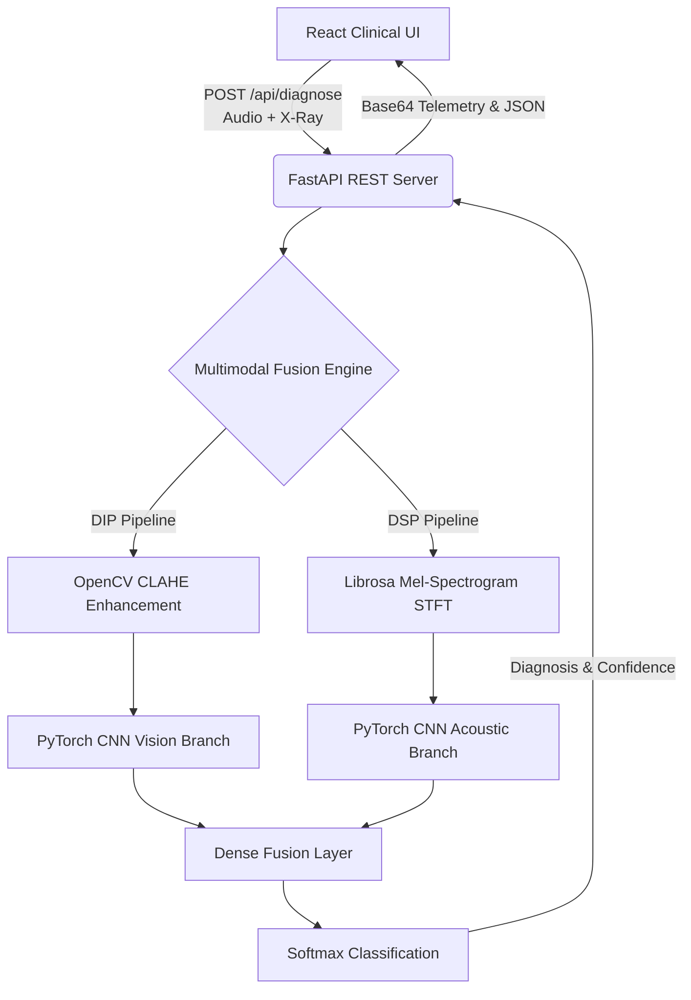

# 🫁 RespiFlow AI
**Enterprise-Grade Multimodal Acoustic-Radiological Diagnostic Platform**

<!-- Badge formatting utilizing the standard Shields.io generation service -->


RespiFlow AI is a decoupled, full-stack medical diagnostic platform engineered for respiratory triage. By simultaneously analyzing chest radiographs and stethoscope auscultations, the deep learning engine fuses spatial and temporal clinical data to detect pneumonia with high confidence.

The system features a clinical-grade React dashboard that streams live Base64 telemetry, Digital Image Processing (DIP) enhancement maps, and Digital Signal Processing (DSP) spectrograms from a PyTorch-powered FastAPI backend.

---

## 🚀 Core Pipelines

- **Acoustic Pipeline (DSP):** Utilizes Librosa for Short-Time Fourier Transforms (STFT), converting raw `.wav` lung sounds (such as the ICBHI dataset) into Mel-spectrograms.
- **Radiological Pipeline (DIP):** Deploys automated Contrast Limited Adaptive Histogram Equalization (CLAHE) via OpenCV to isolate pulmonary opacities.
- **Multimodal Fusion Engine:** A dual-branch PyTorch Convolutional Neural Network (CNN) that extracts independent feature maps from both domains before concatenating them into a single dense classification head.
- **Decoupled Architecture:** An asynchronous FastAPI REST API server processing multipart form data and returning diagnostic JSON telemetry to a Vite-React UI.

## 🧠 System Architecture



## 🛠 Tech Stack

| Tier | Technologies |
| :--- | :--- |
| **Frontend Workstation** | React, Vite, CSS3 (Dark-mode), Lucide-React |
| **REST API Server** | FastAPI, Uvicorn, Python 3.10+, Pydantic |
| **Machine Learning** | PyTorch, Torchvision, Scikit-learn |
| **Data Processing** | OpenCV, Librosa, NumPy, Pandas |

## 📂 Repository Structure

```text
RespiFlow_AI/
├── src/
│   ├── 1_audio_dsp.py       # DSP audio transformations
│   ├── 2_vision_dip.py      # DIP radiographic enhancements
│   ├── 3_model_fusion.py    # PyTorch dual-branch architecture
│   ├── 4_train.py           # Training and validation loops
│   ├── 5_app.py             # Model initialization and inference
│   ├── 6_auto_curator.py    # Dataset ingestion script
│   └── api.py               # FastAPI routing and endpoints
├── respiflow-ui/            # Vite + React Frontend Workspace
│   ├── src/
│   │   ├── App.jsx          # Dashboard UI and State Management
│   │   ├── App.css          # Clinical workstation styling
│   │   └── main.jsx         # React DOM entry
│   └── package.json
├── data/                    # Datasets (Excluded via .gitignore)
├── demo_data/               # Sample .jpeg and .wav files for testing
└── README.md
```

## ⚡ Local Deployment Guide

### 1. Download Model Weights
To run the diagnostic engine, you must download the pre-trained PyTorch weights. 
* Download `model_weights.pth` from **[this Google Drive link](https://drive.google.com/file/d/1_sWM6wVuu_MVeLotE2uNsFF1GYUHdIH-/view?usp=sharing)**.
* Place the file inside the `src/` directory.

### 2. Initialize the Backend (FastAPI & PyTorch)
Navigate to the root directory and start the FastAPI server. This will expose the REST API on port `8000`.

```bash
# Install backend dependencies
pip install fastapi uvicorn torch torchvision torchaudio librosa opencv-python python-multipart

# Launch the inference server
uvicorn src.api:app --reload --host 0.0.0.0 --port 8000

## 📡 REST API Specification

### `POST /api/diagnose`
Accepts a patient's multimodal data and returns a diagnostic payload alongside Base64-encoded telemetry images for dashboard rendering.

**Request:** `multipart/form-data`
* `xray`: Standard `.jpeg` or `.png` chest radiograph.
* `audio`: Standard `.wav` stethoscope auscultation.

**Response:** `application/json`
```json
{
  "diagnosis": "Pneumonia",
  "confidence": 99.97,
  "telemetry": {
    "xray_clahe_base64": "data:image/png;base64,iVBORw0KGgo...",
    "audio_spectrogram_base64": "data:image/png;base64,iVBORw0KGgo..."
  }
}
```
